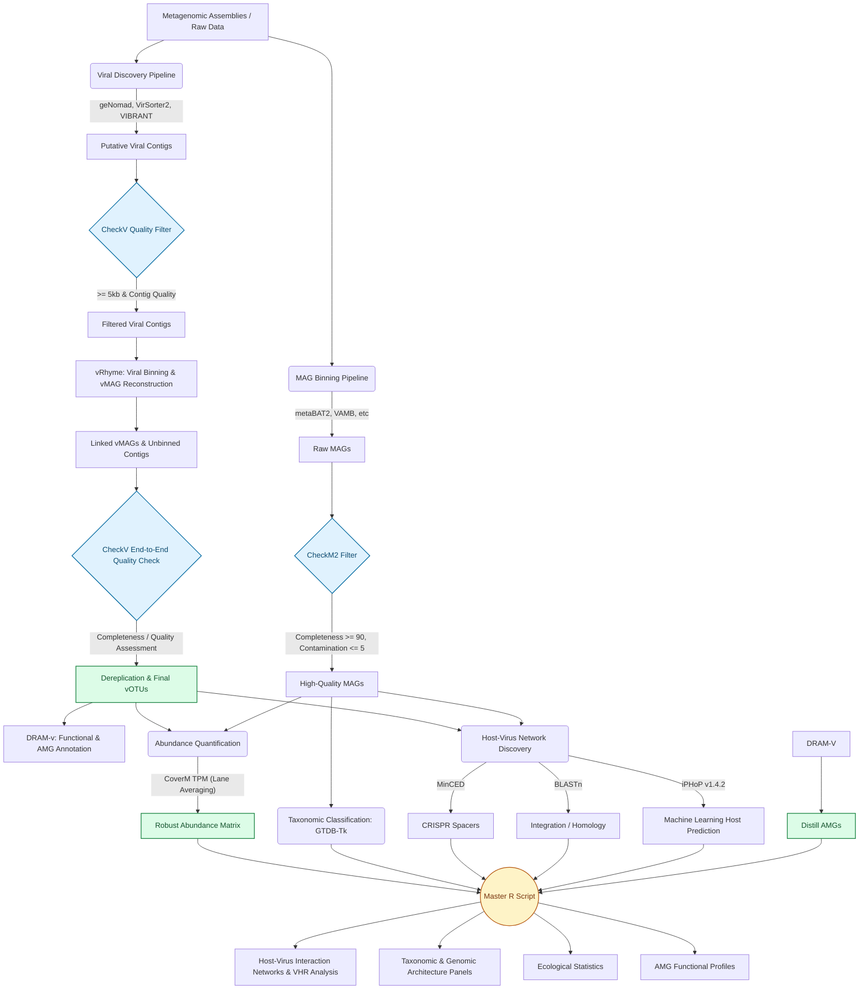

# Viral Metagenomics & Host-Virus Interaction discovery from bulk metagenomes

A comprehensive and highly robust pipeline for viral discovery, quality control, abundance quantification, and host-virus interaction network reconstruction from metagenomic assemblies.

This workflow integrates state-of-the-art tools to reliably identify viral fraction, pair them with their bacterial/archaeal hosts using both empirical (CRISPR/BLAST) and machine-learning (iPHoP) evidence, and visualize the complex ecological dynamics of the community.

<div align="center">
  
</div>

## Pipeline Workflow

The pipeline consists of modular steps, going from raw assemblies to publication-ready visualizations.




## 1 Dependencies instalation 
```bash
git clone [https://github.com/jesussstap/virus_metagenome.git](https://github.com/jesussstap/virus_metagenome.git)
cd virus_metagenome
conda env create -f envs/vrhyme_env.yml
conda env create -f envs/coverm.yml.yml
conda env create -f envs/minced_blast.yml

```


## 2. Viral Discovery & Quality Control
Run the consensus discovery tools on your assembled contigs. Merge the outputs and evaluate viral quality using CheckV.
The master R scripts apply a strict filter to retain only Medium-quality, High-quality, and Complete viral genomes that are >= 5,000 bp (5 kb), adhering to MIUViG standards to prevent false positives from small fragments.

Follow these steps to set up the environments and run the pipeline scripts sequentially.

```bash
conda activate vrhyme
cd virus_metagenome

bash viral_database.sh
```

## 3. vMAGs Construction
Execute the binning and sequence consolidation steps using vRhyme to reconstruct viral Metagenome-Assembled Genomes (vMAGs) from coverage profiles and genomic signatures:

```bash
bash vMAGs_construction.sh
```

## 4. MAG Quality & Taxonomy
Evaluate MAGs using CheckM2. The pipeline automatically filters MAGs retaining those with >=90% completeness and <=5% contamination. Ensure taxonomy is assigned using GTDB-Tk (the R scripts are pre-configured to parse KBase GTDB CSV outputs).

## 5. Abundance Calculation (CoverM)
Generate a unified reference catalog containing both validated MAGs and vOTUs. Map clean reads back to this catalog using CoverM to calculate Transcripts Per Million (TPM) values for the entire community simultaneously.

Crucial Step: Ensure MAG contigs are prepended with their MAG ID and the ___ separator (e.g., MAG_001___NODE_1) before mapping so the R script can accurately aggregate contig abundances into total host abundance.

```bash
community_abundance.sh
```

## 6. Host-Virus Interactions
Run the three pillars of interaction prediction:

CRISPR (MinCED): Extract spacers from MAGs and map them against the viral catalog.

Provirus (BLAST): Identify viral sequences integrated directly into host contigs.

Machine Learning (iPHoP): Predict host-virus pairs based on genomic signatures.

```bash
minced_blast.sh
```

Maintained by the EliLab team.
